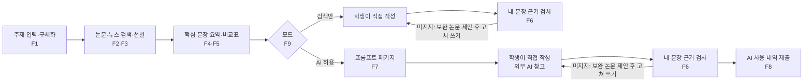

# 수행평가 리서치 서비스 PRD (가칭)

2026-11-08 · @bugeon park

> 상세 명세: [데이터·입력 명세](./데이터-입력-명세.md)
> 초기 버전 웹 문서: https://claude.ai/artifact/VumXJwgvVEc9bw1q2ptQgr (2026-11-08 "외부 AI 미사용" 결정 이전 버전. 이 파일이 최신 기준)

## 개요

고등학생이 탐구 주제를 넣으면 국내외 논문과 뉴스를 찾아 주장-근거 일치를 검증하고, 핵심만 정리해 주는 리서치 도구다. 글은 학생이 쓰고, 서비스는 검증된 자료와 외부 AI에 붙여넣을 코치형 프롬프트 패키지까지만 제공한다.

- **한 줄 정의:** 수행평가 리서치 시간을 줄이고, 믿을 수 있는 근거만 준다.
- **해결할 문제:** 수업 중(태블릿 허용) 짧은 시간 안에 믿을 만한 자료를 찾기 어렵다. 일반 AI는 실존 논문을 가져와도 문장과 맞지 않게 인용한다.
- **핵심 원칙:** 서비스 안에서는 생성형 AI·LLM·머신러닝 모델을 일절 쓰지 않는다. 모든 처리는 우리 코드베이스 안의 수식과 규칙(검색 점수, 문장 유사도, 단서어 사전)으로 한다. 지어낸 문장이 나올 경로가 없고, 비용이 0원이며, 서비스 자체가 "AI 사용"에 해당하지 않는다.
- **제품 목표:**
  1. 리서치 시간 단축
  2. 인용 정밀도가 상용 생성형 검색엔진 평균 74.5%를 넘을 것
  3. 2026학년도 수행평가 AI 활용 규정을 지키는 구조

## 배경과 근거

2026학년도부터 수행평가는 수업 시간 안에서, AI 사용 내역을 밝히는 조건으로만 AI를 쓸 수 있다. 실존 논문 확인은 검색 기반이면 기본값이고, 진짜 문제는 인용이 문장을 실제로 뒷받침하느냐다.

| 근거 | 내용 | 제품 시사점 |
| --- | --- | --- |
| 교육부 수행평가 개선 (2025.7.2) | 모든 수행평가는 수업 시간 내 실시, 과제형·암기식 수행평가 금지 | 사용 장면 = 수업 중 또는 수행 준비 시간 |
| 수행평가 AI 활용 관리 방안 (2025.12.23) | 2026년부터 AI 종류·프롬프트·활용 범위 표기 의무. 생성물을 그대로 내면 부정행위, 자료 수집 목적은 허용 | 완성 문단 생성 금지, AI 사용 내역 자동 생성, 서비스 자체는 AI 미사용 |
| 현장 확인 (사용자) | 대부분의 수행평가와 준비 시간에 태블릿 사용 허용. 교사들도 태블릿으로 AI를 참고하는 것은 막기 어렵다고 함 (한국교육신문) | 태블릿 화면 기준 설계, 빠른 응답 |
| Walters & Wilder (2023), Scientific Reports | 챗GPT가 만든 인용 중 GPT-3.5는 55%, GPT-4는 18%가 존재하지 않는 문헌 | DB 검색 결과에서만 인용하면 가짜 서지는 0건이 기본 조건 |
| Liu, Zhang, Liang (2023), EMNLP Findings | 상용 생성형 검색엔진 문장 중 51.5%만 인용으로 완전히 뒷받침되고, 인용의 74.5%만 해당 문장을 뒷받침 | 핵심 차별점 = 주장-근거 일치 검증, 지표 = 인용 정밀도 |
| Bastani 외 (2025), PNAS | 일반 GPT-4 사용 학생은 접근을 없앤 뒤 17% 낮은 성적. 학습 보호 프롬프트를 넣은 튜터형은 이 효과가 대부분 완화됨 | 프롬프트를 코치형으로 설계 = 가드레일 |

## 타깃 사용자와 사용 시나리오

주 사용자는 수행평가와 탐구보고서를 준비하는 한국 고등학생이다. 학교 태블릿이나 개인 기기로, 수업 중이나 수행 준비 시간에 쓴다.

| 시나리오 | 학생이 하는 일 | 서비스가 주는 것 |
| --- | --- | --- |
| 수업 중 수행평가 (AI 허용) | 주제 입력 후 몇 분 안에 자료 확보 | 논문 3~5편, 뉴스 3~5건, 핵심 문장 요약, 비교표, 프롬프트 패키지, AI 사용 내역 |
| 수업 중 수행평가 (AI 금지, 검색만 허용) | 검색만 모드로 자료 확보 | 위와 같은 자료·요약·비교표·문장 검사. 외부 AI용 프롬프트 패키지와 사용 내역만 숨김 |
| 수행 준비 (사전 조사) | 막연한 주제를 탐구 질문으로 좁힘 | 탐구 질문 후보, 쟁점과 상충 지점 |
| 초안 점검 | 직접 쓴 문장을 넣어 근거 확인 | 문장별 지지·부분 지지·미지지 판정과 근거 문장 |

교사(규정 준수 확인)와 학부모(결제 주체)는 2차 이해관계자다. 이번 PRD는 학생 사용 흐름만 다룬다.

## 범위

MVP는 주제 입력부터 검증된 자료와 프롬프트 패키지 출력까지다. 결제와 요금 관련 기능은 전부 이번 범위에서 뺀다.

**포함 (In scope)**

- 주제 입력, 탐구 질문 구체화, 국내외 논문 검색과 선별, 뉴스 검색
- 핵심 문장 추출 요약, 논문 간 비교표
- 내 문장 근거 검사
- 코치형 프롬프트 패키지, AI 사용 내역 자동 생성
- AI 허용 / 검색만 모드 전환
- 계정과 탐구 기록 저장 (P1)

**제외 (Out of scope)**

- 서비스 내부의 생성형 AI·LLM·ML 모델 사용 (외부 API든 자체 호스팅이든 모두)
- 결제, 구독, 요금제, 무료 사용 횟수 차감 (사업자 등록 후 후속 PRD)
- 완성 문단이나 보고서 본문 생성
- 특정 외부 AI 지정 (프롬프트는 도구 중립)
- 교사·학교용 대시보드
- 네이티브 앱 (웹 PWA로 시작)
- 유료 DB의 국내 논문 원문 열람, 뉴스 기사 본문 수집

## 기능 요구사항

P0 9개가 MVP다. 핵심은 F6 내 문장 근거 검사, F7 프롬프트 패키지, F8 AI 사용 내역으로, 경쟁 서비스와 갈리는 지점이다. 모든 기능은 학생 기기의 브라우저 안에서 처리 엔진 코드의 수식과 규칙으로 처리하며, 계산 방법은 [명세의 처리 엔진 규칙](./데이터-입력-명세.md#처리-엔진-규칙과-수식)에 있다.

| ID | 기능 | 설명 | 처리 방식 | 우선순위 |
| --- | --- | --- | --- | --- |
| F1 | 주제 입력·구체화 | 자유 입력 주제에서 키워드를 뽑고, 탐구 질문 후보 1~3개 제시. 영문 키워드는 KCI 논문의 영문 키워드에서 가져옴 | 규칙 기반 어절 분석 + 질문 템플릿 | P0 |
| F2 | 논문·뉴스 검색 | KCI(국내 논문), OpenAlex(해외 논문), 네이버 뉴스를 병렬 검색, DOI·제목·URL 기준 중복 제거 | API 호출 + 정규화 | P0 |
| F3 | 품질 기반 선별 | 논문은 키워드 일치·피인용·최신성·OA로 3~5편, 뉴스는 키워드 일치·최신성으로 3~5건 선별, 선별 이유 표시 | 점수 공식 | P0 |
| F4 | 핵심 문장 요약 | 논문 초록에서 핵심 문장 3개를 원문 그대로 추출, 목적·방법·결과 태그와 정의 문장 표시 | TextRank + 질의 유사도 + 위치 점수 | P0 |
| F5 | 논문 간 비교표 | 핵심 개념별로 각 논문의 방향(증가·감소·효과 없음·조건부)을 근거 문장과 함께 표시, 일치·상충 표시, 결론은 내리지 않음 | 개념 추출 + 방향 단서어 사전 | P0 |
| F6 | 내 문장 근거 검사 | 학생 문장마다 가장 가까운 근거 문장을 찾아 지지·부분 지지·미지지 판정, 미지지면 보완할 논문 제안 | BM25 + 내용어 포함률 + 방향·수치 일치 규칙 | P0 |
| F7 | 프롬프트 패키지 | 자료 묶음(서지·근거 문장·DOI) + 코치형 지시문 + "대신 쓰지 말 것" 제약, 도구 중립, 원클릭 복사 | 고정 템플릿 | P0 |
| F8 | AI 사용 내역 자동 생성 | 학생이 쓴 외부 AI 종류, 프롬프트 원문, 활용 범위, 일시를 제출용 형식으로 출력 | 고정 템플릿 | P0 |
| F9 | 모드 전환 | AI 허용 / 검색만. 서비스 자체는 두 모드 모두 AI를 쓰지 않으며, 검색만 모드는 외부 AI용 기능(F7·F8)을 화면과 엔진 양쪽에서 비활성 | 엔진 모드 검사 | P0 |
| F10 | 참고문헌 서식 | APA 등 서식으로 자동 출력 | 템플릿 | P1 |
| F11 | 계정·기록 | 소셜 로그인, 탐구 주제별 기록 저장 | - | P1 |
| F12 | 연령·규정 안내 | 외부 AI 연령 요건과 학교별 AI 허용 범위 확인 안내 | 정적 안내 | P1 |
| F13 | 쟁점 지도 | 비교표를 찬반·조건부 구조로 시각화 | F5 결과 재사용 | P2 |
| F14 | 발표 대비 질문 | 교사가 물을 만한 질문 후보 | 질문 템플릿 | P2 |

### P0 수용 기준

- **F2·F3:** 모든 출력 서지·기사는 검색 API가 돌려준 레코드에만 있어야 한다. 서비스가 만든 서지는 0건.
- **F4:** 요약 문장은 초록 문장과 글자 단위로 같아야 한다. 고쳐 쓴 문장 0건.
- **F5·F6:** 모든 판정에 근거 문장이 붙는다. 근거 문장이 없으면 "근거 없음"으로 두고 판정하지 않는다.
- **F7:** 패키지 안 지시문에 본문 작성 요청이 들어가지 않는다.
- **F8:** 프롬프트 원문이 빠짐없이 포함된다.
- **전체:** 앱과 중계 함수에서 외부 AI·LLM API로 나가는 호출 0건. 의존성 목록에 ML 모델·추론 라이브러리 0개.
- **학생 데이터:** 학생이 쓴 문장과 추가 프롬프트는 기기 밖으로 전송되지 않는다 (네트워크 요청에 포함 0건).

## 사용자 흐름

두 모드 모두 같은 검색·요약·비교표·문장 검사를 쓴다. AI 허용 모드에서만 외부 AI에 붙여넣을 프롬프트 패키지와 AI 사용 내역이 추가된다.

## 비기능 요구사항

수업 50분 안에 쓸 수 있는 속도와, 학교 태블릿에서 설치 없이 열리는 가벼운 웹이 기본 조건이다.

| 항목 | 요구사항 | 이유 |
| --- | --- | --- |
| 응답 속도 | 주제 입력부터 결과 화면까지 10초 이내 (목표), 문장 검사 2초 이내 | 외부 API 대기 외에는 기기 안 계산만 하므로 빠르게 가능 |
| 첫 로딩 | 앱 + 사전 파일 합계 1MB 안팎을 목표, 오프라인 캐시 | 학교 와이파이에서도 바로 열려야 함. 신경망 모델을 쓰지 않아 가볍게 유지 가능 |
| 기기 | 태블릿 가로·세로와 분할 화면 폭에서 깨지지 않음, 설치 없는 웹(PWA) | 학교 태블릿은 MDM으로 앱 설치·접속이 통제될 수 있음 (비즈한국) |
| 정확성 | 생성된 서지 0건, 요약은 원문 문장 그대로, 모든 판정에 근거 문장 | 신뢰가 핵심 가치 |
| 재현성 | 같은 입력과 같은 검색 결과면 항상 같은 출력 | 수식 기반이라 가능. 교사가 확인해도 결과가 같음 |
| 개인정보 | 학생 문장은 기기 밖으로 나가지 않음, 우리 쪽 저장소 없음 | 사용자 대부분이 미성년자 |
| 원가 | 리서치 1회 처리 비용 0원. 정적 호스팅과 중계 함수는 무료 범위 안 | 외부 AI 미사용, 데이터 API 무료, 운영 서버 없음 |
| 가용성 | 한 소스 장애 시 다른 소스로 결과 제공, 기기 안 결과 캐시 | 수업 중 실패하면 다시 쓰지 않음 |

## 데이터 소스와 시스템 구조

운영하는 서버는 없다. 데이터는 무료 공개 API 세 개로 받고, 이후 처리는 전부 학생 기기의 브라우저 안에서 우리 코드가 한다. 키가 필요한 KCI·네이버는 키를 붙여 전달만 하는 중계 함수(서버리스, 무료 범위)를 거치고, OpenAlex는 브라우저에서 직접 부른다. 무료 공개에서도 중계 함수가 필요한 이유는 요금이 아니라 키 보호다: 키를 브라우저에 두면 누구나 가져가 한도를 소진시킬 수 있다.

| 소스 | 범위 | 접근 | 주의 |
| --- | --- | --- | --- |
| KCI Open API | 국내 학술지 논문: 제목, 저자, 초록, 연도, 연구분야, 피인용 수, DOI, 영문 키워드 | 무료 키 직접 신청, XML 응답 | 국내 논문 원문은 제한적, 초록 중심 |
| OpenAlex | 해외 논문 메타데이터와 초록 | 브라우저에서 키 없이 직접 호출(사용자 IP마다 하루 약 100회), 막히면 중계 함수의 무료 키로 재시도 | 메타데이터 공백·불일치 정제 필요 |
| 네이버 검색 API (뉴스) | 뉴스 제목, 링크, 요약문, 날짜 | NAVER API HUB, 현재 한시적 무료, 검색 카테고리 합산 월 775,000건 | 본문 미제공, 유료 전환 가능성 → 소스 교체 가능하게 분리 |
| 처리 엔진 (브라우저) | 형태소 분석, 키워드 추출, 문장 분리, 점수, 유사도, 단서어 판정 | 앱 코드 + 규칙·사전 (자체 작성) | 외부 호출 없음 |
| 키 중계 함수 | KCI·네이버(및 OpenAlex 재시도) 요청에 키를 붙여 그대로 전달, 같은 검색은 엣지 캐시로 재사용 | 서버리스 함수 (예: Cloudflare Workers) 무료 범위 | 계산·저장·로그 본문 없음. 남용 방지용 호출 제한만 |

### 처리 순서

1. 주제 → 조사·어미 규칙으로 키워드 추출, 질문 템플릿으로 탐구 질문 후보 생성
2. KCI·네이버 뉴스 검색 (한국어 키워드)
3. KCI 상위 결과의 영문 키워드로 OpenAlex 검색 (학생이 영문 키워드를 넣었으면 그것도 사용)
4. 레코드 정규화, DOI·제목·URL 기준 중복 제거
5. 점수 공식으로 논문 3~5편, 뉴스 3~5건 선별
6. 초록 문장 분리 → 핵심 문장 추출(F4), 개념×논문 방향 표(F5)
7. 출력: 결과 화면, 프롬프트 패키지, AI 사용 내역

### 개발 구조

운영 서버 없이 정적 웹앱(PWA) 하나로 동작한다. 코드는 세 부분으로 나눠 개발한다.

1. **화면 (UI):** 입력을 받고 결과를 보여준다. 판단 로직은 넣지 않는다.
2. **처리 엔진:** 검색 호출, 정규화, 선별, 요약, 비교표, 문장 검사, 템플릿 생성. 화면과는 정해진 함수 인터페이스로만 연결하고, 화면 없이 단위 테스트할 수 있게 만든다. 무거운 계산은 Web Worker에서 돌려 화면이 멈추지 않게 한다.
3. **키 중계 함수:** KCI·네이버 요청에 키를 붙여 전달만 한다. 수십 줄 규모.

언어는 화면과 엔진 모두 TypeScript로 통일한다. 입력 명세, 엔진 인터페이스, 공통 데이터 모델, 처리 수식, 저장 정책은 [데이터·입력 명세](./데이터-입력-명세.md)에 정리했다.

## 성공 지표와 MVP 검증 계획

가장 중요한 지표는 인용 정밀도다. 상용 생성형 검색엔진 평균 74.5%를 넘어야 "믿을 만하다"를 숫자로 말할 수 있다.

| 지표 | 정의 | 목표 | 측정 방법 |
| --- | --- | --- | --- |
| 인용 정밀도 | 붙인 근거 중 해당 문장을 실제로 뒷받침하는 비율 (Liu 외 2023 정의) | 74.5% 초과 | 결과 샘플을 사람이 판정 |
| F6 판정 정확도 | 지지·부분·미지지 판정이 사람 판정과 일치하는 비율 | 테스트에서 기준값 설정, 임계값 조정에 사용 | 판정 세트 100문장으로 비교 |
| 리서치 시간 | 주제 입력부터 쓸 자료 확정까지 걸린 시간 | 기존 방식보다 단축 (기준값은 테스트에서 측정) | 같은 주제로 기존 방식(검색, 일반 AI)과 비교 |
| 미지지 탐지 | F6가 근거 없는 문장을 미지지로 잡아낸 비율 | 테스트에서 기준값 설정 | 일부러 넣은 근거 없는 문장으로 검사 |
| 재사용률 | 다음 수행평가에서도 다시 쓴 사용자 비율 | 테스트에서 기준값 설정 | 사용 기록 |
| 가짜 서지 | 존재하지 않는 서지 출력 건수 | 0건 | 전수 DOI·제목 대조 |

### 검증 계획

1. **대상:** 같은 학교 학생 10~20명
2. **기간:** 실제 수행평가 1회 주기
3. **방법:** 같은 주제로 기존 방식과 서비스를 번갈아 사용, 위 지표 측정
4. **판단:** 지표 결과로 계속 개발할지, Frontling 한국판 기능으로 흡수할지 결정

## 리스크와 대응

가장 큰 리스크는 대필 도구로 오인되는 것이고, 수식 기반으로 바꾸면서 새로 생긴 리스크는 판정 정확도다.

| 리스크 | 영향 | 대응 |
| --- | --- | --- |
| 대필 도구로 오인 | 교사·학부모 반발, 사용자가 부정행위로 처리될 수 있음 | 본문 생성 없음, 서비스 내부 AI 미사용, 코치형 프롬프트, AI 사용 내역 자동 생성 |
| 수식 판정의 정확도 한계 | 같은 뜻을 다른 단어로 쓴 문장을 미지지로 판정, 반어·복잡한 문장 오판 | 판정마다 근거 문장을 함께 보여줘 학생이 확인, 동의어 사전, 테스트 세트로 임계값 조정, 애매하면 "부분 지지"로 보수적 판정 |
| 한·영 교차 검사 | 한국어 학생 문장과 영어 초록은 단어가 겹치지 않음 | KCI 한·영 키워드 쌍으로 만든 대응 사전으로 확장, 해외 논문 판정은 "참고" 표시 |
| 쉬운 말 요약 불가 | 요약이 원문 문장이라 고교생에게 어려울 수 있음 | 정의 문장 추출, 용어 사전 연결(P1), 목적·방법·결과 태그 |
| 학교 태블릿에서 차단 | 수업 중 사용 불가 | 웹 PWA, "AI 미사용 검색 도구"로 차단 명분 축소 |
| 무료 경쟁 서비스 (DBpia AI) | "왜 이걸 쓰냐"에 답 못 하면 이탈 | 내 문장 근거 검사, 지어내지 않는 구조, 속도, 규정 대응으로 차별화 |
| 외부 AI 연령 약관 | Claude는 만 18세 이상, ChatGPT는 13~18세 보호자 동의 필요 | 도구 중립 프롬프트, 연령 요건 안내 (F12) |
| 데이터 품질 | 초록 누락·메타데이터 오류로 잘못된 선별 | 정규화, 초록 없는 논문은 후순위 |
| 네이버 API 유료 전환 | 뉴스 기능 비용 발생 | 뉴스 소스 어댑터 분리, 공지 시 대체 소스 검토 |
| 무료 공개 후 공유 한도 소진 | KCI·네이버는 우리 키 하나를 전체가 나눠 씀 (네이버 검색 합산 월 77.5만 건 ≈ 하루 2.5만 건, KCI는 키 발급 후 확인) | 중계 엣지 캐시로 같은 검색 재사용, 기기 캐시, 기기당 분당 호출 제한. 한도 근접 시 뉴스부터 끄고 논문 우선 |
| 중계 함수 남용 | 다른 사람이 우리 중계로 호출해 한도 소진 | 허용 출처(우리 도메인)만 받기, 기기 ID별 호출 제한, 필요한 파라미터만 통과 |
| 저사양 태블릿 성능 | 첫 로딩 지연, 계산 중 버벅임 | 사전 파일 캐시, Web Worker, 처리 대상 문장 수 상한 |

## 마일스톤과 오픈 이슈

데이터가 나오기 전에는 추가 개발도 철수도 판단하지 않는다.

1. **1주차, 수요 조사와 사전 준비:** 학생 인터뷰, 실제 수행평가 과목·형식·AI 허용 범위 수집. KCI·네이버·OpenAlex 키 신청, 단서어 사전과 F6 판정 세트 준비
2. **개발:** P0 기능(F1~F9) MVP
3. **2~3주, 반응 확인과 수정:** 실제 수행평가에서 10~20명 사용, 지표 측정과 임계값 조정
4. **판단:** 계속 개발 또는 Frontling 한국판 기능으로 흡수

### 오픈 이슈

- [ ] 서비스 이름
- [ ] KCI Open API 키 발급과 호출 한도, 영문 키워드 필드 제공 여부 확인
- [ ] 초록만으로 근거 검사(F6)가 충분한지 검증
- [ ] 방향 단서어·동의어 사전 초안 (교과 주제 중심)
- [ ] 규칙 토크나이저 정확도 점검 (교과 주제 명사 사전 보강), 저사양 태블릿 성능 확인
- [ ] 정적 호스팅과 중계 함수 플랫폼 선정 (무료 범위)
- [ ] 학교별 AI 사용 내역 제출 형식 수집 (F8 출력 형식)
- [ ] Frontling 한국판과의 관계 (별도 서비스 또는 기능 흡수)
- [ ] 결제와 무료 사용 정책 (사업자 등록 후 후속 PRD)

## 참고 자료

- 대학저널: 교육부, 중·고교 수행평가 수업 시간 내 시행 (2025.7.2)
- 인사이트: 수행평가 시 AI 사용 기록 제출
- 브런치: 2026년 바뀐 규칙과 탐구보고서
- 한국교육신문: 생성 AI 시대 보고서 부과 및 평가방법
- Walters & Wilder (2023), Scientific Reports
- Liu, Zhang, Liang (2023), Evaluating Verifiability in Generative Search Engines
- Bastani 외 (2025), PNAS
- 공공데이터포털: KCI 논문정보
- KCI Open API 사용 안내 (MCP 서버 문서)
- OpenAlex (arXiv 2205.01833)
- OpenAlex 한계 분석 (arXiv 2512.16434)
- [NAVER API HUB 개요](https://guide.ncloud-docs.com/docs/apihub-overview)
- DBpia: 탐구 보고서 작성 AI 활용 가이드
- 비즈한국: 서울시교육청 MDM
- Anthropic Consumer Terms of Service
- OpenAI Help: Is ChatGPT safe for all ages?
